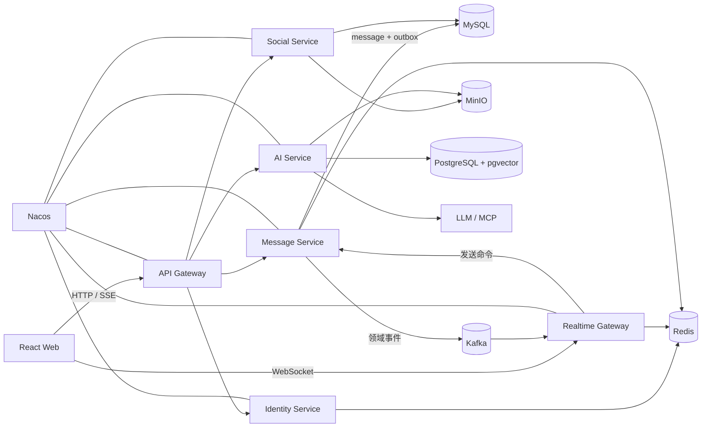

# NexusAI

面向实时通信、AI 对话与知识库问答的一体化智能协作平台。

NexusAI 以 Java 微服务和事件驱动架构为基础，围绕用户关系、私聊群聊、可靠消息、WebSocket 实时投递、AI Chat、RAG 知识库等能力展开。项目以生产级约束为设计目标，在实现业务功能的同时，重点处理身份安全、消息幂等、顺序、一致性、断线恢复、多节点路由、可观测性与故障恢复。

> 当前状态：工程基线和 AuthService 的账号注册、密码登录、Access/Refresh Token、轮换复用检测与当前会话退出链路已经实现，多设备会话管理和 Redis 登录限流已实现并经人工验证，限流返回 HTTP 429 与 Retry-After；认证专项自动化验证仍待补齐。README 中标记为“规划”的功能不代表当前已经可用。

## 项目目标

- 构建完整的用户、好友、群组、会话和消息系统。
- 使用 Netty WebSocket 支持低延迟双向通信。
- 使用 Kafka 与 Outbox 实现可靠的异步消息链路。
- 支持多设备、消息 ACK、已读回执和断线增量同步。
- 使用 Redis 管理登录状态、Presence、缓存、限流和临时状态。
- 使用 MinIO 管理头像、聊天附件和知识库原始文档。
- 使用 LangChain4j 构建流式 AI Chat、Memory、Tools 和 MCP 能力。
- 使用 PostgreSQL/pgvector 构建带权限、引用和评测的 RAG 知识库。
- 建立数据库迁移、自动化测试、指标、日志、链路追踪和部署体系。

## 核心功能规划

### 账号与安全

- 邮箱注册、密码登录和验证码登录。
- Access Token、Refresh Token 轮换与撤销。
- 多设备登录会话与设备管理。
- 安全密码哈希、登录限流和防账号枚举。
- Gateway 统一认证与下游可信身份。
- 对象级授权和越权防护。

### 社交关系

- 用户资料与头像。
- 好友搜索、申请、同意、拒绝、删除和拉黑。
- 好友申请过期与系统通知。
- 群聊创建、邀请、踢人、退群和成员角色。
- 私聊、群聊和 AI 会话统一管理。

### 消息系统

- 文本消息、回复、撤回和消息状态。
- `clientMessageId` 发送幂等。
- 会话内单调消息序号 `seq`。
- 基于游标的历史消息分页。
- `STORED`、`DELIVERED`、`READ` 分层 ACK。
- Outbox、Kafka 幂等消费、重试和死信队列。
- 多设备读进度、未读数和断线增量同步。

### 实时通信

- Netty WebSocket Server。
- 握手认证、心跳与空闲连接检测。
- 用户、设备、节点与 Channel 映射。
- 私聊、群聊、系统通知和 AI 消息实时投递。
- Redis Presence 和多节点定向路由。
- 慢连接背压、连接限流和故障恢复。

### 文件与对象存储

- MinIO 预签名直传。
- 文件元数据和 PENDING/READY 生命周期。
- 文件大小、MIME、哈希和上传完成校验。
- 私有下载、访问授权和孤儿对象清理。
- 头像、聊天附件和 RAG 文档统一管理。

### AI Chat

- 同步与流式模型调用。
- 会话记忆、上下文窗口和历史摘要。
- AI 消息复用普通消息存储与权限模型。
- 异步生成、取消、超时、重试和模型限流。
- 时间、邮件与 MCP 搜索工具。
- 工具执行确认、权限校验、幂等和审计。

### RAG 知识库

- 知识库、文档、Chunk 和摄取任务管理。
- MinIO 文档上传与异步解析。
- 增量切块、去重、Embedding 和版本管理。
- PostgreSQL/pgvector 向量检索。
- ACL 权限过滤、混合召回和 Rerank。
- 回答引用、删除同步、无损重建和 RAG 评测。

## 目标架构

以下为最终目标，并非首版一次性引入全部组件。开发按 `docs/development-roadmap.md` 的闭环演进顺序推进：认证入口 → 单节点私聊与断线补拉 → Outbox/Kafka 可靠性升级 → ACK、多设备与多节点 → 社交、文件、AI/RAG 和前端完整交付。各阶段保留清晰限制、安全约束和验证证据。



## 模块规划

| 模块 | 职责 | 当前状态 |
|---|---|---|
| `nexus-common-kernel` | 极少量稳定公共类型，不包含业务 Entity 和基础设施实现 | 已创建 |
| `nexus-auth-service` | 账号、凭据、登录会话、Token 和验证码 | 实现中 |
| `nexus-api-gateway` | HTTP 路由、认证入口、限流和安全边界 | 已实现 Auth 路由、JWT 入口认证和单层代理 Header 清理；生产部署隔离待补 |
| `nexus-social-service` | 用户资料、好友、群组和会话成员 | 规划中 |
| `nexus-message-service` | 消息顺序、幂等、存储、历史、读游标和 Outbox | 规划中 |
| `nexus-realtime-gateway` | Netty WebSocket、Presence、协议和在线投递 | 规划中 |
| `nexus-ai-service` | AI Chat、Memory、Tools、MCP 和 RAG | 规划中 |
| `nexus-web` | React 用户界面和 WebSocket 客户端 | 规划中 |

模块遵循单向依赖和单一数据所有者原则。跨服务协作通过版本化 API 或领域事件完成，不共享数据库持久化实体。

## 技术栈

### 后端

- Java 21
- Spring Boot 3.5
- Spring Cloud Gateway
- Spring Security
- Spring Cloud OpenFeign
- Spring Cloud LoadBalancer
- Spring Cloud Alibaba Nacos
- MyBatis-Plus
- Flyway
- Netty
- Apache Kafka
- Redis
- Canal
- ShedLock
- MinIO
- LangChain4j
- PostgreSQL + pgvector

### 前端

- React
- TypeScript
- Vite
- HTTP / SSE / WebSocket

### 测试与工程化

- JUnit 5
- Testcontainers
- Maven Wrapper
- Docker Compose
- Spring Boot Actuator
- Springdoc OpenAPI / Swagger UI
- Micrometer
- Prometheus / Grafana
- OpenTelemetry
- CI 质量门和依赖/Secret 扫描

## 关键设计原则

### 可信身份

客户端不能通过请求参数决定自己是谁。业务操作的 `actorId` 必须来自经过验证的 Token 或服务端安全上下文，所有资源访问执行对象级授权。

### 先持久化，再投递

聊天消息在数据库事务中完成权限校验、幂等判断、序号分配以及 `message + outbox` 写入。事务提交后再发布事件和执行实时投递，避免“已推送但未保存”。

### 至少一次与幂等

网络请求、Outbox 发布和 Kafka 消费均按至少一次语义设计。重复请求和重复事件通过业务唯一键、幂等记录和状态约束安全处理。

### 基于序号的同步

消息历史和断线恢复使用 `(conversationId, seq)` 游标，不依赖客户端时间或一次断线时间。用户成员关系维护送达和已读水位。

### 缓存不承担唯一真相

MySQL 保存核心业务真相。Redis 和 Canal 构建可回源、可重建的临时状态或查询投影；缓存故障不应破坏消息正确性。

### AI 工具最小权限

模型输出被视为不可信建议。邮件、知识写入等外部副作用必须经过参数校验、授权、必要的用户确认、幂等执行和审计。

## 当前目录

```text
NexusAI/
├── .mvn/
├── docs/
│   ├── architecture-improvement-ledger.md
│   └── development-roadmap.md
├── nexus-common-kernel/
│   └── pom.xml
├── .gitignore
├── mvnw
├── mvnw.cmd
├── pom.xml
└── README.md
```

## 环境要求

- JDK 21
- Maven 3.9.9，推荐直接使用项目内 Maven Wrapper
- Git
- Docker
- Docker Compose

当前已验证环境：macOS ARM64、OpenJDK 21、Maven 3.9.9、Docker 29、Docker Compose 5。

## 构建方式

```bash
./mvnw clean verify
```

检查 Common 模块依赖边界：

```bash
./mvnw -pl nexus-common-kernel dependency:tree
```

当前 Common 应保持纯 Java JAR，不应出现 Spring Web、MySQL、Redis、Nacos 或 AI 相关依赖。

## Gateway 本地启动

Gateway 默认监听 `127.0.0.1:8080`，AuthService 默认位于 `127.0.0.1:8081`。在启动进程环境中注入与 AuthService 相同的 `JWT_ACCESS_TOKEN_SECRET`（Base64、至少 256 bit），issuer 默认 `nexus-auth-service`；网关不需要数据库或 Redis。

```bash
./mvnw -pl nexus-api-gateway spring-boot:run
```

可用 `AUTH_SERVICE_URI` 覆盖下游地址、`GATEWAY_PORT` 覆盖网关端口。项目根目录 `.env` 不代表 Maven/Java 进程会自动加载这些变量，请通过 IDE 或 shell 显式注入，勿提交实际密钥。

- 匿名 POST：`/api/accounts`、`/api/auth/login`、`/api/auth/token/refresh`、`/api/auth/logout`。
- 健康探测：GET `/actuator/health` 及子路径。
- 其他 `/api/auth/**`：要求 Bearer Access Token；未知入口默认拒绝。
- 原样转发路径和 Authorization，不使用 StripPrefix。下游继续验证 JWT、Session 和资源所有权。
- 当前为共享 HMAC 密钥、双层验证方案；已实现单层代理来源 IP，服务间认证、网络隔离及多级代理尚未实现，不能直接部署为最终生产安全架构。

### 单层代理与来源 IP

Gateway 在出站请求头过滤链末尾清理 `Forwarded`、`X-Forwarded-*`、`X-Real-IP`、约定身份 Header 和客户端 `X-Nexus-*`，根据真实连接对端重新设置唯一的 `X-Nexus-Client-IP`；不传递用户身份 Header 来代替 JWT。两服务均显式使用 `server.forward-headers-strategy=none`，避免框架先按客户端转发头改写连接对端；网关默认的 Forwarded/X-Forwarded 生成也已关闭。

AuthService 默认不信任任何代理，只在连接对端属于 `AUTH_TRUSTED_PROXY_ADDRESSES` 的精确 IP 列表时读取该自定义头；只接受一个 IPv4/IPv6 字面量。重复、空白、逗号链、主机名、端口或非法值均回退到连接对端 IP；普通 X-Forwarded-For 始终不作为来源依据。

本地单层开发时，可在 **AuthService 进程**显式设置：

```text
AUTH_TRUSTED_PROXY_ADDRESSES=127.0.0.1
```

不设置时，经网关访问的 IP 限流仍按网关对端地址计数。配置不接受 CIDR、主机名或通配符。信任 `127.0.0.1` 同时信任所有能从该地址连接的本机进程，不是 Gateway 身份证明；生产必须结合可达性限制/网络隔离，必要时使用服务间认证。当前 Gateway 直接面向客户端，不支持未经设计就放在另一层代理之后。

Gateway 自身测试无需 MySQL、Redis 或真实 AuthService：

```bash
./mvnw -pl nexus-api-gateway -am clean verify
```

## AuthService API 文档

AuthService 启动后可以访问：

```text
OpenAPI JSON：http://localhost:8081/api/v3/api-docs
Swagger UI：http://localhost:8081/api/swagger-ui.html
```

本地默认启用。部署到生产环境时设置：

```text
OPENAPI_ENABLED=false
SWAGGER_UI_ENABLED=false
```

随着各服务和基础设施逐步实现，README 将补充 Docker Compose 启动、数据库迁移、服务启动和端到端验证命令。

